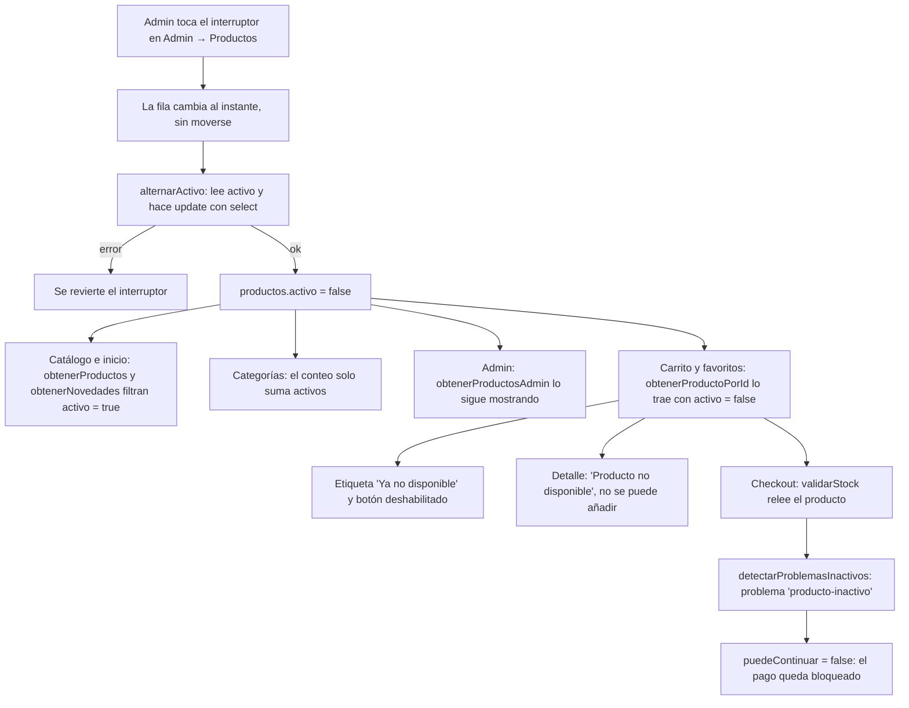
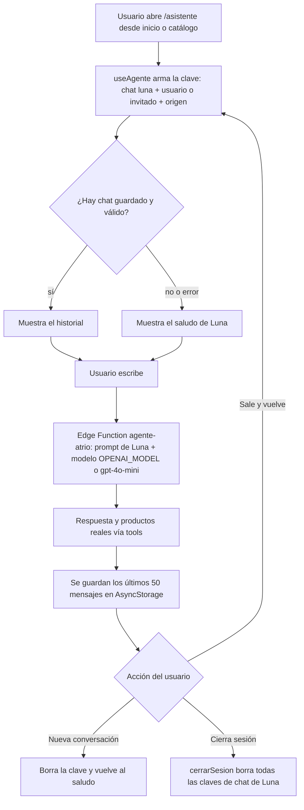
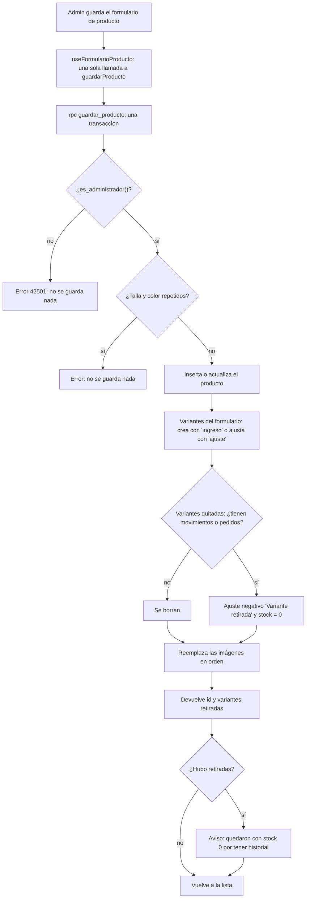
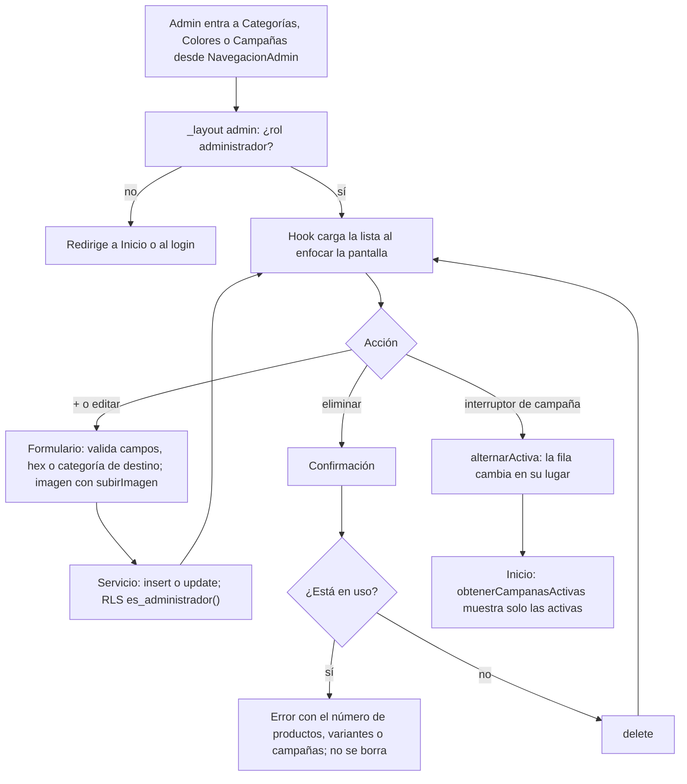
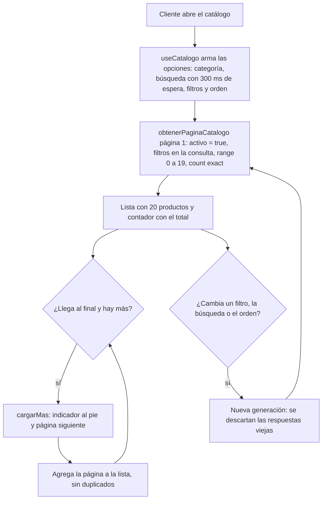

# Auditoría de correcciones — área de Yeiner Carrión

- **Rama:** `yeiner/correcciones`, creada desde `52955ea`.
- **Fechas:** pasos 1, 2 y 5 el 28 de octubre de 2026; pasos 3 y 4 el 29 de octubre de 2026.
- **Área:** productos, variantes, stock, catálogo, detalle, carrito, administración de productos y asistente Luna.

## Estado general

Los cinco pasos están implementados. Los pasos 3 y 4 estuvieron bloqueados hasta que el esquema base de Alexander (`supabase/migrations/20260901_esquema_base.sql`) llegó a la rama con el merge de `origin/main` (`233f582`). Ese merge lo hizo Yeiner.

**Todos los pasos tienen pendiente la validación manual en la app.** Yeiner la hará al final, paso por paso. Lo que cada paso ya tiene verificado está en su sección "Cómo se validó".

**Línea base:**
- `npm run typecheck` pasaba con 0 errores antes del primer cambio.
- También pasaba con 0 errores después del merge con `main`, antes del paso 3.

**Herramientas que no hay en el entorno:**
- **ESLint:** no está configurado ni instalado en el repo, así que no se corrió `lint`. Instalarlo cuenta como dependencia nueva, y eso requiere aprobación.
- **CLI de Supabase y Docker:** tampoco están instalados. El SQL del paso 3 **no se probó en una base local**.

**Cambios previos guardados en un stash:** antes de crear la rama, los cambios sin confirmar de `main` se guardaron en `stash@{0}` ("cambios previos antes de yeiner/correcciones"). Se usó `git stash push` sin `-u`, porque con `-u` se habrían movido `node_modules/` y `.env`. Ese stash no se aplicó ni se modificó. Contiene:
- logs de depuración en el login;
- un cambio en `app/direcciones.tsx`;
- el `.gitignore` que reescribió Expo CLI;
- un primer intento del paso 1 con la opción `incluirInactivos`.

---

## Paso 1: ocultar productos inactivos

### Problema original

`servicioProductos.obtenerProductos`, `obtenerNovedades` y `obtenerCategorias` (en `src/services/servicioProductos.ts`) no filtraban `activo = true`. Un producto desactivado desde el admin seguía apareciendo en el catálogo y en inicio, contaba en su categoría y se podía añadir al carrito.

Durante las pruebas manuales aparecieron cuatro problemas más, que se corrigieron dentro del mismo paso:

1. En Admin → Productos, tocar el interruptor de activo también abría el detalle del producto (`FilaProductoAdmin`: el `Switch` estaba dentro del `Pressable` de la fila).
2. Al activar o desactivar un producto, cambiaba de posición en la lista. Se recargaba la lista entera y `fecha_alta` es solo una fecha, así que los empates volvían en otro orden.
3. En Favoritos, el botón "AÑADIR" seguía activo con productos inactivos y los metía directo al carrito.
4. El interruptor tardaba en responder: `alternarActivo` hacía 3 viajes a Supabase.

### Qué se corrigió

| Archivo | Cambio |
|---|---|
| `src/services/servicioProductos.ts` | `obtenerProductos` y `obtenerNovedades` filtran `activo = true`. Nuevo `obtenerProductosAdmin()` sin ese filtro, que desempata por `id`. `obtenerCategorias` cuenta solo productos activos. `obtenerProductoPorId` sigue sin filtro, a propósito. `alternarActivo` pasa de 3 viajes a 2. |
| `src/hooks/useAdminProductos.ts` | Usa `obtenerProductosAdmin()`. El interruptor cambia la fila al instante, sin recargar la lista, y revierte el cambio si Supabase lo rechaza. |
| `src/services/servicioAdmin.ts` | Usa `obtenerProductosAdmin()` en el dashboard y en el stock bajo. |
| `src/components/admin/FilaProductoAdmin.tsx` | El `Switch` queda fuera del `Pressable` que abre el detalle. |
| `src/hooks/useDetalleProducto.ts` | `errorSeleccion` pasa a ser `string \| null`. Con un producto inactivo, `agregarAlCarrito` devuelve `false` con el mensaje "Este producto ya no está disponible." |
| `app/producto/[id].tsx` | Aviso "Producto no disponible" y botón "NO DISPONIBLE" deshabilitado. |
| `src/components/cart/ItemCarrito.tsx` | Etiqueta "Ya no disponible". |
| `src/components/products/FilaFavorito.tsx` | Etiqueta "Ya no disponible" y botón deshabilitado. |
| `src/types/Checkout.ts` (Segundo) | Nuevo código `'producto-inactivo'` en `ProblemaCheckout`. |
| `src/utils/checkout.ts` (Segundo) | Nueva función `detectarProblemasInactivos`. `detectarProblemasStock` deja de reportar inactivos para no duplicar el aviso; Yeiner aprobó este cambio. |
| `src/hooks/useCheckout.ts` | `validarStock` suma `detectarProblemasInactivos`, así que el pago queda bloqueado. |

`src/services/servicioReportes.ts` no se tocó, por decisión de Yeiner. Sigue usando `obtenerProductos()`, que ahora devuelve solo activos. Ahí solo se usa para generar pedidos de ejemplo, así que no se rompe nada.

### Flujo de funcionamiento



### Cómo se validó

- `npm run typecheck`: 0 errores después de cada commit.
- `lint`: no disponible (ver arriba).
- **SQL:** no aplica.
- Antes de cambiar firmas se buscaron con grep todos los usos de `obtenerProductos`, `errorSeleccion`, `alternarActivo` y `codigo`. No hay ningún `switch` sobre `codigo` que se rompa con el valor nuevo.
- **Pruebas manuales de Yeiner:**
  - desactivó productos desde el admin;
  - encontró y reportó los 4 problemas de la lista de arriba;
  - confirmó la corrección de Favoritos.

  No consta una pasada final completa de todas las pruebas: catálogo, inicio, conteo de categoría y bloqueo del checkout.

### Riesgos y pendientes

- **Carrito de invitado:** se guarda en el dispositivo con una copia del producto, así que la etiqueta solo aparece si el producto ya estaba inactivo al añadirlo. Aun así, el checkout siempre lo bloquea, porque relee el producto.
- **Política de lectura de `productos`:** resuelto. El esquema base la define como `lectura_publica` / `productos_lectura_publica` con `USING (true)`, así que los clientes pueden leer los inactivos. Por eso carrito, favoritos y detalle los muestran como "no disponible" en vez de hacerlos desaparecer. **No hay que cambiar esa política.**
- **`confirmar_compra` no revisa `productos.activo` (pendiente de Hans y Alexander):** la app bloquea el checkout, pero alguien que llame a la API directamente puede comprar un producto inactivo. Arreglo propuesto, no implementado: agregar en `confirmar_compra` un rechazo cuando `p.activo` sea falso, sin tocar la política de lectura.
- **Doble toque rápido:** si se toca el interruptor dos veces muy seguido, se lanzan dos peticiones. La interfaz termina mostrando lo que devuelve la última.

---

## Paso 2: corregir a Luna

### Problema original

- `supabase/functions/agente-atrio/openai.ts`: el modelo por defecto era `gpt-5.6-luna`, que no es un id publicado por OpenAI. Si el secreto `OPENAI_MODEL` no estaba definido, todas las llamadas fallaban.
- `supabase/functions/agente-atrio/index.ts`: el `SYSTEM_PROMPT` no le daba nombre a la asistente.
- `src/hooks/useAgente.ts`: el chat vivía solo en memoria y se perdía al salir de la pantalla.

### Qué se corrigió

| Archivo | Cambio |
|---|---|
| `supabase/functions/agente-atrio/openai.ts` | `MODELO_POR_DEFECTO = 'gpt-4o-mini'` y comentario actualizado. |
| `supabase/functions/agente-atrio/index.ts` | El prompt empieza con "Te llamas Luna y eres la asistente virtual de ATRIO, una tienda de ropa." El resto de reglas no cambió. |
| `src/services/storageService.ts` | Nueva clave `chatLuna: 'atrio.chat.luna'` y nueva función `eliminarDatosConPrefijo()`. |
| `src/hooks/useAgente.ts` | Saludo de Luna. Carga y guarda el chat con la clave `atrio.chat.luna.<usuarioId \| invitado>.<origen>`, hasta 50 mensajes. Valida lo leído; si falla, empieza con el saludo. `limpiarConversacion`, que no se usaba, pasa a ser `nuevaConversacion()` y además borra lo guardado. Se partió del último commit, con sus comentarios originales. |
| `app/asistente.tsx` | Título "Luna" y botón "Nueva conversación", deshabilitado mientras responde o si solo está el saludo. |
| `src/services/servicioAutenticacion.ts` (Alexander) | `cerrarSesion` borra todas las claves `atrio.chat.luna*` al inicio, también con la huella activa. |

### Flujo de funcionamiento



### Cómo se validó

- `npm run typecheck`: 0 errores. La Edge Function es Deno y `tsc` no la revisa; el cambio son dos cadenas de texto y se revisó a mano.
- `lint`: no disponible.
- **SQL:** no aplica.
- Se buscaron con grep todos los usos de `useAgente` y `limpiarConversacion`. Se confirmó que `/asistente` está dentro de `AuthProvider`, así que `useAuth` funciona ahí.
- **Pruebas manuales:** pendientes. Necesitan desplegar antes la función (ver comandos). No consta que Yeiner las haya hecho.

### Riesgos y pendientes

- Sin `supabase functions deploy agente-atrio`, Luna en producción sigue con el prompt y el modelo viejos.
- **Costo:** la API de OpenAI cobra por uso a la cuenta dueña de `OPENAI_API_KEY`. Se recomienda poner un tope mensual en Billing → Limits.
- Si el usuario sale de la pantalla mientras Luna responde, esa respuesta se pierde. La pregunta sí queda guardada.
- `supabase/config.toml`, línea 7, todavía tiene el comentario de ejemplo `OPENAI_MODEL=gpt-5.6-luna`. No se tocó porque no estaba en el alcance.

---

## Paso 3: guardar el producto en una sola transacción

### Problema original

`servicioProductos.crearProducto` hacía 3 inserciones, y `actualizarProducto` + `actualizarVariantesEImagenes` hasta 6 operaciones más, todas desde el celular (`src/services/servicioProductos.ts`, usadas en `src/hooks/useFormularioProducto.ts`). Si una fallaba a la mitad, el producto quedaba incompleto: sin variantes, sin fotos o con el stock a medias.

Además, quitar una talla o un color con historial fallaba a mitad del guardado. `movimientos_stock.variante_id` e `items_pedido.variante_id` son FK `ON DELETE RESTRICT`, así que esas variantes no se pueden borrar.

### Decisiones de Yeiner

1. **Stock inicial:** al crear un producto, cada variante con stock > 0 registra un movimiento `ingreso` con motivo `'Stock inicial'`. Antes, `crearProducto` no registraba movimientos.
2. **Variantes quitadas:**
   - sin filas en `movimientos_stock` ni en `items_pedido`: se borran;
   - con historial: no se borran. Si tienen stock, se registra un `ajuste` negativo por todo su stock con motivo `'Variante retirada'` y quedan en stock 0. La función las devuelve y la app avisa: "Las variantes X quedaron con stock 0 porque tienen historial."

### Qué se corrigió

| Archivo | Cambio |
|---|---|
| `supabase/migrations/20261029_guardar_producto.sql` (nuevo) | Función `public.guardar_producto(p_producto jsonb, p_variantes jsonb, p_imagenes jsonb) returns jsonb` (detalle abajo). |
| `src/services/servicioProductos.ts` | `guardarProducto(datos, idExistente?)` reemplaza a `crearProducto`, `actualizarProducto` y `actualizarVariantesEImagenes`, que se eliminaron porque no quedaba ningún uso. Mantiene `generarIdProducto` y el mensaje de SKU duplicado (código `23505` con "sku"). Devuelve el producto y las variantes retiradas. |
| `src/hooks/useFormularioProducto.ts` | Crear y editar pasan a ser una sola llamada. Avisa de las variantes retiradas con `Alert` en el celular y con `window.alert` en web, donde `Alert` con botones no se muestra. |

Detalle de `guardar_producto`:
- Es `security invoker`, así que se aplican las RLS de admin del esquema base. Lo primero que hace es comprobar `public.es_administrador()`; si no lo es, devuelve el error `42501`.
- Inserta el producto si no existe (`popularidad_30d = 0`, `fecha_alta = current_date`, `activo = true`). Si existe, lo actualiza sin tocar `sku`, `activo`, `popularidad_30d` ni `fecha_alta`.
- **Variantes:**
  - si es nueva, la crea con un `ingreso` cuando el stock es mayor que 0, con el motivo `'Stock inicial'` al crear el producto;
  - si cambió su stock, registra un `ajuste` por la diferencia;
  - si se repiten talla y color, rechaza **todo** el guardado.
- Variantes quitadas: según la decisión 2.
- Reemplaza las imágenes y conserva el orden del arreglo (`orden` = posición − 1).
- No tiene permiso de ejecución para `anon`; solo para `authenticated`.

### Flujo de funcionamiento



### Cómo se validó

- `npm run typecheck`: 0 errores.
- `lint`: no disponible.
- **SQL sin probar en local** (no hay Docker ni CLI). Se revisó contra el esquema real:
  - columnas;
  - CHECK de `movimientos_stock` (`ingreso` > 0, `ajuste` con cualquier signo);
  - UNIQUE `(producto_id, talla, color_id)`;
  - FK RESTRICT de `movimientos_stock` e `items_pedido`;
  - FK CASCADE de `items_carrito`;
  - políticas de admin.
- **Aplicada en producción por Yeiner, a mano, en el SQL Editor** (29/10/2026), no con `supabase db push`. Una consulta de solo lectura a `pg_proc` confirmó:
  - `es_security_definer = false`;
  - `authenticated` puede ejecutarla;
  - `anon` no puede.
- La línea 24 del esquema base (`CREATE SCHEMA public;`) no se tocó, porque no se corrió `supabase db reset`.
- Se buscaron con grep todos los usos de las tres funciones reemplazadas: no queda ninguno.
- **Pruebas manuales:** pendientes:
  - crear con 2 colores, 3 tallas y 2 fotos;
  - editar stock y fotos a la vez;
  - SKU repetido;
  - quitar una variante con historial;
  - quitar una sin historial.

### Riesgos y pendientes

- **Una variante con historial queda con stock 0 en vez de borrarse.** En el detalle aparece agotada, y al volver a abrir el formulario su talla o color aparecen marcados otra vez, con stock 0. Para ocultarla haría falta una columna `activa` en `variantes_producto`. **Pendiente, no implementado.**
- No se pudo probar que una talla y color repetidos hagan fallar todo sin dejar filas a medias, porque no hay base local. La función lo rechaza antes de escribir nada.
- Desde este paso, el formulario de productos **depende de que la función exista en la base**. Ya está aplicada en producción. En cualquier otro entorno hay que aplicar la migración antes.

---

## Paso 4: admin de categorías, colores y campañas

### Problema original

Las categorías, los colores y las campañas solo se podían editar desde el dashboard de Supabase (Table Editor). En `app/admin/` no había pantallas para hacerlo.

### Políticas verificadas (sin migración nueva)

En el esquema base ya existen:
- `categorias_escritura_admin` y `colores_escritura_admin`, con `USING`/`WITH CHECK public.es_administrador()`;
- "Administradores gestionan campañas", para `ALL`;
- la lectura pública de las tres tablas (en `campanas`, solo las activas).

Por eso **no se creó la migración de políticas** que pedía el prompt original.

### Qué se corrigió

| Archivo | Cambio |
|---|---|
| `src/services/servicioCatalogoAdmin.ts` (nuevo) | Crear, editar y borrar categorías y colores (detalle abajo). `elegirYSubirImagen()` usa `servicioProductos.subirImagen`. |
| `src/services/servicioCampana.ts` | Agrega `obtenerTodas`, `crear`, `actualizar`, `alternarActiva` y `eliminar`, que sí lanzan error. `obtenerCampanasActivas` y su respaldo no cambiaron. |
| `src/types/Campana.ts` | `CampanaAdmin` (`CampanaInicio` + `id` + `activa`) y `DatosCampana`. Se exportan desde `types/index.ts`, que ya reexportaba `./Campana`. |
| `src/hooks/useAdminCategorias.ts`, `useAdminColores.ts`, `useAdminCampanas.ts` (nuevos) | Carga al enfocar la pantalla, guardar (crear o editar) y eliminar. En campañas, la activación cambia la fila en su lugar. |
| `src/components/admin/FormularioCategoria.tsx` (nuevo) | Nombre, subcategorías separadas por comas e imagen. |
| `src/components/admin/FormularioColor.tsx` (nuevo) | Nombre y hex validado con `^#[0-9A-Fa-f]{6}$`, con muestra en vivo. |
| `src/components/admin/FormularioCampana.tsx` (nuevo) | Etiqueta, título, texto del botón, categoría de destino elegida de la lista, imagen y si está activa. |
| `app/admin/categorias.tsx`, `colores.tsx`, `campanas.tsx` (nuevos) | Estructura de `app/admin/productos`: acciones, navegación, encabezado con +, formulario arriba y lista. En campañas, el interruptor queda fuera de la zona que abre la edición. |
| `src/components/admin/NavegacionAdmin.tsx` | Agrega Categorías (`pricetags-outline`), Colores (`color-palette-outline`) y Campañas (`megaphone-outline`). |
| `src/utils/confirmar.ts` (nuevo, fuera de la lista del prompt) | Confirmación antes de borrar que funciona también en web (`window.confirm`). |

Detalle de `servicioCatalogoAdmin`:
- El id de categorías y colores sale del nombre, porque esas columnas son `text` sin valor por defecto. Al editar, el id no cambia.
- Antes de borrar, cuenta lo que los usa:
  - una categoría no se borra si la usa algún producto (activo o no) o alguna campaña, porque `campanas.categoria_destino` no es FK;
  - un color no se borra si lo usa alguna variante. El mensaje dice "N productos lo usan (M variantes)".

`app/admin/_layout.tsx` no se tocó. Usa un `Stack` genérico con la guarda de rol, así que las tres pantallas nuevas ya quedan protegidas.

### Flujo de funcionamiento



### Cómo se validó

- `npm run typecheck`: 0 errores.
- `lint`: no disponible.
- **SQL:** no aplica (sin migración).
- Se verificó que las políticas existen en el esquema base y que `_layout` protege las rutas nuevas.
- **Pruebas manuales:** pendientes:
  - crear una campaña con imagen y verla en el carrusel de Inicio;
  - desactivarla y comprobar que sale de Inicio;
  - intentar borrar un color en uso: debe mostrar el número y no borrarlo;
  - crear, editar y borrar una categoría de prueba;
  - entrar con la cuenta de cliente a las tres URLs: debe redirigirse.

### Riesgos y pendientes

- Al editar o borrar una categoría, Inicio y el catálogo del cliente lo muestran recién la próxima vez que cargan esas pantallas.
- Las imágenes de categorías o campañas borradas quedan en el bucket `productos`, sin uso. No se borran porque podrían estar compartidas.
- Dos nombres que generan el mismo id (por ejemplo "Polos" y "polos") dan el error "Ya existe una categoría con el identificador…".

---

## Paso 5: paginar el catálogo

### Problema original

`src/hooks/useCatalogo.ts` descargaba todos los productos de una vez con `obtenerProductos()` y filtraba y ordenaba en memoria. "Cargar más" solo cortaba esa lista con `slice`. Con un catálogo grande, eso son descargas lentas y mucho uso de memoria y datos.

### Qué se corrigió

| Archivo | Cambio |
|---|---|
| `src/services/servicioProductos.ts` | Nueva función `obtenerPaginaCatalogo(...)` (detalle abajo). |
| `src/hooks/useCatalogo.ts` | Paginación en el servidor. Vuelve a la página 1 cuando cambian los filtros, la búsqueda o el orden, y `cargarMas` agrega la página siguiente. Descarta respuestas tardías y la búsqueda espera 300 ms. Devuelve lo mismo que antes, más `cargandoMas`. |
| `app/(tabs)/catalogo.tsx` | Indicador de carga al pie de la lista. |

Detalle de `obtenerPaginaCatalogo(...)`:
- Trae solo productos activos, de 20 en 20 con `.range()`.
- Los filtros van en la consulta:
  - categoría y precio máximo;
  - búsqueda por nombre o por nombre de categoría, combinadas con `or`;
  - tallas, colores y "solo disponibles", con embeds `!inner` con alias. Así cada producto sigue trayendo todas sus variantes.
- Usa `count: 'exact'` para el contador de resultados.
- Desempata por `fecha_alta` y luego por `id`.
- Devuelve `{ productos, hayMas, total }`. Se agregó `total` porque la pantalla muestra "N RESULTADOS".

### Flujo de funcionamiento



### Cómo se validó

- `npm run typecheck`: 0 errores.
- `lint`: no disponible.
- **SQL:** no aplica.
- Se revisó que `useCatalogo` solo se use en `catalogo.tsx` y que `FiltrosCatalogo` y `OrdenCatalogo` sigan iguales para `PanelFiltros`.
- **Comparación antes y después:** se escribió un script (fuera del repo, en el scratchpad de la sesión) que compara 4 combinaciones de filtros con valores reales:
  1. todo;
  2. talla + color + "solo disponibles", ordenado por precio;
  3. categoría + búsqueda + precio máximo, ordenado por popularidad;
  4. búsqueda por nombre de categoría.

  Revisa que no falten ni sobren productos, que no haya repetidos, que el total sea el mismo y que lleguen todas las variantes. No se ejecutó: consulta la base de producción (solo lectura) y necesitaba autorización. No consta que Yeiner lo haya corrido.
- **Pruebas manuales de Yeiner:** revisó el panel de filtros y el comportamiento de "LIMPIAR". No consta el resto de las pruebas.

### Riesgos y pendientes

- **Sin verificar contra Supabase:** el filtrado por variantes con alias `!inner`. Si PostgREST lo rechaza, el catálogo mostraría un error al usar filtros de color o "solo disponibles". El script de comparación lo detecta.
- **Filtro de talla sin interfaz:** `FiltrosCatalogo.tallas` existe y se filtra en el servidor, pero `PanelFiltros` nunca tuvo una sección para elegir talla. Se propuso agregarla y quedó pendiente por decisión de Yeiner.
- Cada cambio de filtro ahora es una consulta a la red. Con conexión lenta, los resultados anteriores siguen en pantalla hasta que llegan los nuevos.
- "Sin resultados" se ve un instante mientras carga la primera página. Pasaba igual antes del cambio.
- `obtenerProductos()` ya no se usa en el catálogo. Se mantiene por compatibilidad: la usa `servicioReportes` para los datos de ejemplo.

---

## Tabla resumen

| Paso | Archivos tocados | Estado | Quién debe revisar |
|---|---|---|---|
| 1. Ocultar inactivos | `servicioProductos.ts`, `useAdminProductos.ts`, `servicioAdmin.ts`, `FilaProductoAdmin.tsx`, `useDetalleProducto.ts`, `app/producto/[id].tsx`, `ItemCarrito.tsx`, `FilaFavorito.tsx`, `Checkout.ts`, `utils/checkout.ts`, `useCheckout.ts` | Completo (faltan pruebas manuales finales) | Yeiner; Segundo (checkout); Alexander (RLS y `confirmar_compra`) |
| 2. Luna | `openai.ts`, `agente-atrio/index.ts`, `storageService.ts`, `useAgente.ts`, `app/asistente.tsx`, `servicioAutenticacion.ts` | Completo (falta desplegar y probar) | Yeiner; Alexander (`cerrarSesion`) |
| 3. Transacción `guardar_producto` | `supabase/migrations/20261029_guardar_producto.sql` (nuevo), `servicioProductos.ts`, `useFormularioProducto.ts` | Completo; aplicado en producción; SQL sin probar en local; faltan pruebas manuales | Yeiner; Alexander (migración y esquema base) |
| 4. Admin de categorías, colores y campañas | `servicioCatalogoAdmin.ts`, `useAdminCategorias.ts`, `useAdminColores.ts`, `useAdminCampanas.ts`, `FormularioCategoria.tsx`, `FormularioColor.tsx`, `FormularioCampana.tsx`, `app/admin/categorias.tsx`, `colores.tsx`, `campanas.tsx`, `utils/confirmar.ts` (nuevos); `servicioCampana.ts`, `types/Campana.ts`, `NavegacionAdmin.tsx` | Completo (faltan pruebas manuales) | Yeiner |
| 5. Paginación del catálogo | `servicioProductos.ts`, `useCatalogo.ts`, `app/(tabs)/catalogo.tsx` | Completo (falta la comparación contra la base o las pruebas de filtros) | Yeiner |

### Pendientes que no se implementaron (decisión de Yeiner)

- Selector de talla en `PanelFiltros` (paso 5).
- Columna `activa` en `variantes_producto` para ocultar las variantes retiradas (paso 3).
- Rechazo de productos inactivos en `confirmar_compra` (Hans y Alexander).
- El comentario de ejemplo `OPENAI_MODEL=gpt-5.6-luna` en `supabase/config.toml` (paso 2).

## Comandos que debe correr Yeiner

Ninguno se ejecutó desde esta rama.

```bash
# Paso 2: modelo de Luna y despliegue de la función (con créditos cargados en OpenAI)
supabase secrets set OPENAI_MODEL=<modelo disponible en la cuenta de OpenAI>
supabase functions deploy agente-atrio

# Paso 5: comparación antes/después del catálogo (solo lectura), desde la raíz del repo
node <ruta-del-script>/comparar-catalogo.mjs
```

**Migraciones:**
- `20261029_guardar_producto.sql` ya se aplicó a mano en el SQL Editor (paso 3).
- El paso 4 no tiene migración.
- **No usar `supabase db push` contra producción** hasta que Alexander alinee el historial de migraciones (`supabase migration repair`). Si no, intentaría volver a ejecutar `20260901_esquema_base.sql` y las migraciones de septiembre sobre tablas que ya existen.

## Revisión de seguridad

- **No hay claves en el código.** Se buscaron JWT, `sk-`, contraseñas en URLs, `service_role` y `apikey` en todo lo agregado por la rama (`52955ea..HEAD`, sin el esquema base de Alexander), sin resultados. El script de comparación lee `.env` en tiempo de ejecución y no imprime sus valores. Este documento tampoco contiene secretos.
  - Aparte: el merge con `main` trajo el borrado de `supabase/.temp/*` (`linked-project.json`, `pooler-url`, `project-ref`…), hecho por Alexander en `0f9416e`. Ahora `.gitignore` los ignora. Ninguno contiene contraseñas, pero **siguen en el historial de git** desde `3f2c309`.
- **Todas las funciones SQL nuevas verifican el rol de administrador.** `guardar_producto`, la única función nueva, empieza con `if not public.es_administrador() then raise exception … using errcode = '42501'`, es `security invoker` (las RLS de admin se siguen aplicando) y no tiene permiso de ejecución para `anon`.
- **Ninguna pantalla nueva es visible para clientes.** Las tres pantallas nuevas (`app/admin/categorias.tsx`, `colores.tsx`, `campanas.tsx`) están dentro de `app/admin/`, que protege `_layout.tsx` (no se tocó). Además, las escrituras las limitan las políticas `*_escritura_admin` y "Administradores gestionan campañas". En las pantallas de clientes, los cambios son avisos y botones deshabilitados (detalle, carrito, favoritos), el título y el botón de Luna, y el indicador del catálogo.
- **Ningún archivo cambió fuera de lo indicado**, con estas excepciones, todas pedidas o aprobadas por Yeiner:
  - `src/components/admin/FilaProductoAdmin.tsx`: arreglo del interruptor que abría el detalle.
  - `src/hooks/useAdminProductos.ts` y `alternarActivo` en `servicioProductos.ts`: posición estable y respuesta inmediata del interruptor.
  - `src/utils/checkout.ts`, en `detectarProblemasStock`: una condición, para no duplicar el aviso de inactivo.
  - `src/services/storageService.ts`, con la función `eliminarDatosConPrefijo`: necesaria para borrar los chats al cerrar sesión.
  - `src/utils/confirmar.ts` (nuevo): confirmación de borrado que funciona en web.
  - No se creó la migración de políticas del paso 4, porque ya existían.

  No se tocaron checkout, pagos, pedidos, autenticación (salvo la línea indicada en `cerrarSesion`), perfil, configuración ni reportes. No se modificó el esquema base. No se implementó el generador de outfits. No se instalaron dependencias. Desde esta herramienta no hubo `push`, `pull`, `merge` ni `--force`: el push de la rama y el merge con `main` (`233f582`) los hizo Yeiner. No se tocaron los stash.

## Avisos a otros integrantes

- **Segundo:**
  - `src/types/Checkout.ts`: código nuevo `'producto-inactivo'`.
  - `src/utils/checkout.ts`: función nueva `detectarProblemasInactivos`; `detectarProblemasStock` ya no reporta inactivos.
  - `src/hooks/useCheckout.ts`: `validarStock` llama a la función nueva.
- **Alexander:**
  - `src/services/servicioAutenticacion.ts`: `cerrarSesion` borra los chats de Luna al inicio. Se verificó que la línea sigue ahí después del merge con `main`.
  - Migración nueva `20261029_guardar_producto.sql`: depende de `public.es_administrador()` y de las políticas de admin del esquema base. Ya está aplicada en producción, a mano.
  - Historial de migraciones: hay que alinearlo antes de que alguien use `supabase db push`.
  - Línea 24 del esquema base (`CREATE SCHEMA public;`): no se tocó. Hará fallar `supabase db reset` en local, porque Supabase ya crea el esquema `public`. Arreglo sugerido: `CREATE SCHEMA IF NOT EXISTS public;`.
  - El mensaje del commit de merge `233f582` quedó con el texto de plantilla de git. Es solo estético.
- **Hans y Alexander:** `confirmar_compra` no revisa `productos.activo`. Quien llame a la API directamente puede comprar un producto inactivo. Arreglo propuesto: rechazar dentro de `confirmar_compra` si `p.activo` es falso, **sin cambiar la política de lectura de `productos`**, porque carrito y favoritos necesitan leer los inactivos.
